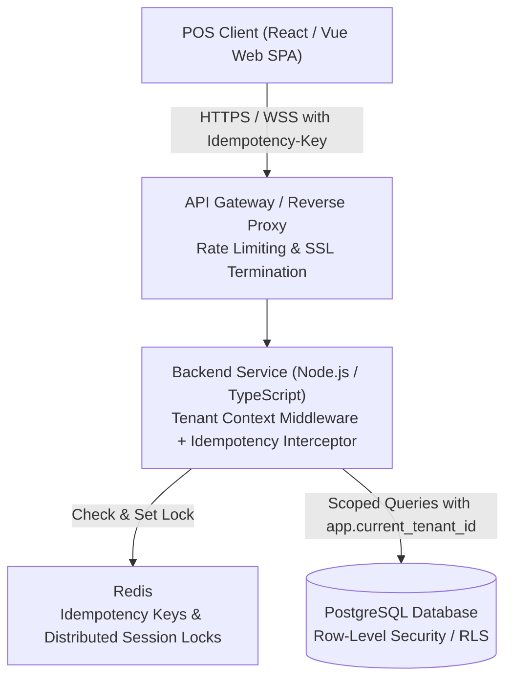

# SaaS POS (Point of Sale) System Design & Architecture Specification

A production-grade, multi-tenant SaaS Point of Sale system built for high reliability, data isolation, and retail speed with native support for product variants and a dedicated **cash-only payment architecture**.

---

## 1. Core Modules & Essential Features

### 1. Dashboard & Analytics
- **Today's Key Metrics:** Gross sales, net revenue, total order count, average order value (AOV).
- **Inventory Alerts:** Total active SKUs/variants, low-stock alerts, out-of-stock items.
- **Recent Activity:** Live stream of recent cash transactions and top-selling variants.

### 2. Product & Variant Catalog Management
- **Catalog Hierarchy:** Categories, brands, tags, and units of measure (UOM: pcs, kg, etc.).
- **Parent Product vs. Variant Architecture:**
  - **Parent Product (Template):** Name, description, brand, category, media/images, option definitions (e.g., "Size", "Color").
  - **Product Variant (Salable SKU):** The actual purchasable unit with its own unique **SKU**, **Barcode**, **Retail Price**, **Cost Price**, and **Weight**.
  - **Architectural Rule:** *Every product has at least one variant.* A "simple" product is modeled as a parent product with 1 default variant. This eliminates conditional checks in the checkout, inventory, and cart engines.
- **Variant Options Engine:** Multi-attribute combinations (e.g., Size: S, M, L $\times$ Color: Red, Blue).
- **Stock Tracking:** Tracked strictly at the **Variant** level with reorder thresholds and low-stock alerts per variant.

### 3. POS Terminal / Fast Checkout (Cash-Only Engine)
- **Barcode Scanning:**
  - Directly scans a variant's unique barcode/UPC and instantly adds that specific variant to the cart.
- **Search & Variant Selection:**
  - Searching/clicking a parent product with multiple variants opens an instant **Variant Selector Drawer** (e.g., select Size $\rightarrow$ select Color $\rightarrow$ add to cart).
  - One-tap selection for single-variant products.
- **Item Search & Cart:** Quick catalog search, grid shortcuts, quantity adjustments, item notes.
- **Discounts:** Item-level and cart-level discounts (percentage or fixed amount).
- **Tax & Total Engine:** Subtotal calculation, line-item tax calculation, rounding precision.
- **Cash-Only Checkout & Change Due Calculator:**
  - **Quick Tender Buttons:** Shortcuts for exact total, rounded denominations (e.g., $10, $20, $50, $100), and numeric keypad input.
  - **Change Calculator:** Instant display of change due (`change_due = amount_tendered - total_payable`).
  - **Tender Validation:** Rejects checkout if `amount_tendered < total_payable`.
  - **Auto Cash Drawer Kick:** Sends electronic pulse to open the cash drawer immediately upon confirming cash payment.

### 4. Sales, Receipts & Ledger
- **Financial Immutability:** Sales records are strictly append-only financial ledger entries (never updated or deleted).
- **Variant Snapshot Engine:** Every line item captures a static snapshot of:
  - `product_name`, `variant_name` (e.g., "Classic Cotton T-Shirt - L / Navy Blue")
  - `variant_id`, `sku`, `barcode`
  - `unit_price`, `unit_cost` at the moment of sale
  - `tax_rate_percent`, `tax_amount`
  - `discount_amount`
- **Receipts:** ESC/POS raw thermal printing (80mm / 58mm), auto-cut command, digital PDF receipt showing variant breakdown, cash tendered, and change returned.
- **Cash Reversals:** Full or partial returns/refunds logged as reversal transactions referencing the original `sale_id`, dispensing cash refund and returning variant stock.

### 5. Inventory Control & Movements
- **Variant-Level Stock Deductions:** Atomic row-level decrement targeting `variant_id` upon sale completion.
- **Stock Movements Ledger:** Every quantity change logged per variant with `movement_type` (`SALE`, `PURCHASE`, `RETURN`, `ADJUSTMENT_DAMAGE`, `ADJUSTMENT_COUNT`, `TRANSFER`).
- **Low-Stock Triggers:** Real-time badge indicators on terminal and dashboard based on variant threshold.

### 6. Customer Management (CRM Light)
- **Walk-in Profile:** Default guest checkout profile.
- **Customer Profiles:** Name, phone number, email, address, tax/VAT ID.
- **Purchase History:** Past orders, total spend, cash transaction records.

### 7. Users & Roles (RBAC)
- **Platform Superadmin / SaaS Owner:** Global platform management, tenant provisioning, manual plan assignments, and activating/suspending tenant shops.
- **Store Owner (Tenant Admin):** Shop configuration, store profile, cashier/manager user management, business analytics.
- **Store Manager:** Catalog management, inventory adjustments, sales history.
- **Cashier:** Scan products, process cash checkouts, reprint receipts.

### 8. SaaS Multi-Tenancy & Shop Settings
- **Tenant Profile:** Business registration, store profile, address, tax identifier, currency code, decimal formatting.
- **Receipt Template Customization:** Header logo, store details, tax breakdown, return policy footer.
- **Owner-Managed Plans (No Payment Gateway):** Subscription plans and account status (`Trial`, `Active`, `Suspended`, `Expired`) are managed 100% manually by the SaaS platform owner. No online card gateway, Stripe, or checkout integration required.

---

## 2. System Architecture & Engineering Decisions



### 1. Multi-Tenancy & Data Isolation Model
- **Strategy:** Shared Database, Shared Schema with **PostgreSQL Row-Level Security (RLS)**.
- **Implementation:**
  - Every tenant-owned table contains `tenant_id UUID NOT NULL`.
  - Application middleware extracts `tenant_id` from validated JWTs and executes:
    ```sql
    SET LOCAL app.current_tenant_id = 'tenant-uuid-here';
    ```
  - Enforced at database engine level via RLS policies:
    ```sql
    ALTER TABLE sales ENABLE ROW LEVEL SECURITY;
    CREATE POLICY tenant_isolation_policy ON sales
      USING (tenant_id = current_setting('app.current_tenant_id')::uuid);
    ```
  - Prevents cross-tenant data leaks even in the event of an application-level bug or raw SQL query omission.

### 2. Primary Keys & Distributed ID Strategy
- **Standard:** Use **UUIDv7** (or ULID) for all entity primary keys.
- **Rationale:**
  - **Time-Ordered:** Preserves B-tree clustering and high insert performance compared to random UUIDv4.
  - **High Concurrency:** Avoids database sequence bottleneck and lock contention across multiple checkout lanes.

### 3. Idempotency & Network Resilience
- Every cash checkout submission requires an `Idempotency-Key: <UUIDv7>` header generated by the frontend checkout session.
- **Backend Flow:**
  1. Check Redis for `idempotency:tenant_id:key`.
  2. If present and status is `COMPLETED`, immediately return the cached receipt payload (HTTP 200).
  3. If present and status is `PROCESSING`, reject concurrent duplicates with HTTP 409 Conflict.
  4. Acquire key lock, process database transaction, cache result, and release lock.
  - Eliminates duplicate records and double stock reductions from double-clicks or browser retries.

### 4. Concurrency Control on Variant Inventory
- Avoid naive `SELECT quantity` followed by `UPDATE quantity`.
- Use **atomic conditional updates** targeting the specific variant to prevent overselling across concurrent checkout lanes:
  ```sql
  UPDATE inventory
  SET quantity = quantity - :sold_qty,
      updated_at = NOW()
  WHERE variant_id = :variant_id
    AND tenant_id = :tenant_id
    AND quantity >= :sold_qty;
  ```
- If rows affected is `0`, rollback the transaction and return an `OUT_OF_STOCK` domain exception with variant details.

### 5. Hardware & Peripheral Integration (Cash Drawer Focus)
- **Thermal Receipt Printers:**
  - Standardize on **ESC/POS** byte protocol (support for 58mm / 80mm).
  - Web communication via **WebUSB / Web Serial API** or a lightweight local WebSocket print bridge (e.g., QZ Tray or Go daemon).
- **Cash Drawer (Critical Peripheral):**
  - Connected via RJ11 directly to the thermal receipt printer.
  - Triggered automatically on cash checkout by transmitting the kick-drawer pulse command (`ESC p 0 25 250`).
- **Barcode Scanners:**
  - Support standard USB/Bluetooth HID Keyboard Emulation.
  - Implement a global keyup/keydown interceptor listening for character sequences terminated by `Enter` with inter-key timing $< 50\text{ ms}$.

---

## 3. Core Database Entities (Schema Design)

```
tenants
  ├── id (UUIDv7, PK)
  ├── name, code, currency, status, plan_name, plan_expires_at, created_at
  │
  ├── users (id, tenant_id, role, email, password_hash)
  │
  ├── categories (id, tenant_id, name, slug)
  │
  ├── products (id, tenant_id, category_id, name, description, has_variants, is_active)
  │     ├── product_options (id, tenant_id, product_id, name, position) 
  │     │     └── product_option_values (id, tenant_id, option_id, value)
  │     │
  │     └── product_variants (id, tenant_id, product_id, variant_name, sku, barcode, retail_price, cost_price, is_active)
  │           ├── variant_option_values (id, tenant_id, variant_id, option_id, option_value_id)
  │           └── inventory (id, tenant_id, variant_id, quantity, low_stock_threshold)
  │
  ├── customers (id, tenant_id, name, phone, email, balance)
  │
  ├── sales (id, tenant_id, cashier_id, customer_id, invoice_number, subtotal, discount, tax, total, payment_method='CASH', amount_tendered, change_due, payment_status, created_at)
  │     └── sale_items (id, tenant_id, sale_id, product_id, variant_id, product_name, variant_name, sku, barcode, unit_price, unit_cost, quantity, tax_amount, total_price)
  │
  └── stock_movements (id, tenant_id, variant_id, reference_id, movement_type, quantity_change, previous_quantity, new_quantity, created_at)
```

---

## 4. MVP vs. Postponed Scope Matrix

| Module | Version 1 (MVP) Scope | Postponed to Later Versions |
| :--- | :--- | :--- |
| **Tenancy & Auth** | Single-shop isolation (Postgres RLS), Standard Email/Password login with role checks | Multi-branch / multi-warehouse support |
| **Catalog & Variants** | **Full Variant Support:** Parent-variant model, option types (Size, Color), unique SKU/barcode per variant, individual variant price/cost/inventory | Composite / Bill of Materials (BOM) bundles, automated matrix generation with 10,000+ variants |
| **Checkout (POS)** | Barcode direct-to-variant scanning, Variant selection drawer, Cart, Discounts, ESC/POS printing | Customer-facing secondary display (CFD), Table ordering |
| **Payments** | **Strictly Cash-Only:** Quick tender buttons, exact cash shortcut, live change due calculator, auto cash drawer kick (`ESC p`) | Credit/Debit Cards, Mobile Wallets/UPI, Split tenders, Integrated card terminals, Buy Now Pay Later |
| **Inventory** | Real-time variant stock counts, Atomic sale deductions, Manual adjustments, Movement history | Purchase Orders (PO), Supplier automated restocking |
| **SaaS Plans** | **100% Owner-Managed:** Platform superadmin manually creates shops, assigns plans, and sets expiry dates (Trial/Active/Expired/Suspended). Zero payment gateway integration needed. | Online self-service credit card billing (Stripe) |

---

## 5. Phased Implementation Roadmap

1. **Phase 1: Foundation & Security Layer**
   - Setup PostgreSQL with UUIDv7, tenancy schema, and Row-Level Security (RLS).
   - Implement JWT authentication and tenant resolver middleware.

2. **Phase 2: Product & Variant Catalog Engine**
   - Category and Parent Product CRUD endpoints.
   - Option definitions (`product_options`, `product_option_values`) and Variant generator (`product_variants`).
   - Single-product abstraction (auto-creating 1 default variant behind the scenes).
   - Variant-level inventory tracking with atomic update operations and `stock_movements` ledger.

3. **Phase 3: POS Cash Checkout Core**
   - Cart calculations (Tax, Discounts) and Idempotency key interceptor.
   - Cash tender validation & change calculation (`change_due = amount_tendered - total`).
   - Atomic checkout transaction:
     $$\text{Sale with Tender \& Change} \longrightarrow \text{Sale Items Variant snapshot} \longrightarrow \text{Variant stock deduction} \longrightarrow \text{Trigger Cash Drawer Pulse}$$

4. **Phase 4: Receipts, Peripherals & Client UX**
   - Web receipt template and ESC/POS thermal printing generator (printing total, cash tendered, change due).
   - Barcode scanner event listener and Variant selection drawer modal.
   - Keyboard navigation shortcuts.

5. **Phase 5: Reporting & SaaS Controls**
   - Daily, weekly, and monthly sales reports, variant sales velocity, and gross profit reporting.
   - Tenant settings, business profile, and receipt customization.
   - Platform Superadmin controls to manually provision shops, assign plans, and set expiry dates.
